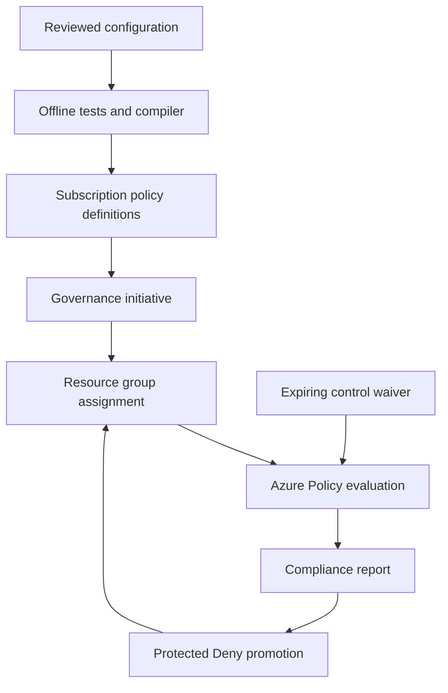

# Azure Policy Guardrails

An auditable Azure governance release system: compile four custom policies into a subscription initiative, assign that initiative to one existing resource group in Audit mode, review compliance, then deliberately promote to Deny. Exceptions are time-limited waivers tied to a change ticket and explicit initiative controls. A dependency-free Python CLI produces deterministic ARM templates and normalizes Azure compliance exports.

## Architecture



| Control reference | Behavior | Scope/mode |
| --- | --- | --- |
| `locations` | Resource location must be in the configured list; global resources are excluded | Indexed resource types |
| `tags` | Each configured tag must exist and have a nonempty value | Indexed resource types |
| `storage-tls` | Storage accounts must explicitly require TLS 1.2 | All, constrained to storage accounts |
| `storage-public-blob` | Storage accounts must explicitly disable anonymous blob access | All, constrained to storage accounts |

Indexed policies apply only to resource types supporting tags and location. They do not enforce tags or location on the resource group itself. The storage anonymous access control does not disable the storage account public network endpoint; private networking is a separate concern.

## Repository

To publish this prepared source archive yourself when GitHub repository creation is available, extract it into its own folder, sign in with GitHub CLI, initialize a new local git repository there, and run the commands below. Verify `gh api user --jq .login` returns `dotman01k` first. These commands create a new public repository; do not run them against an existing unrelated checkout.

```bash
git init -b main
git add README.md config.json guardrails tests scripts examples docs .github .gitignore
git commit -m "Add Azure Policy governance release system"
gh repo create dotman01k/azure-policy-guardrails --public --source . --remote origin --push
```

If that repository already exists, inspect its ownership and contents instead of using force push or overwriting it. After publication, review the validation workflow result. Authenticated deployment remains a separate, explicit action.

| Path | Responsibility |
| --- | --- |
| `config.json` | Unique namespace, regions and tag names |
| `guardrails/core.py` | ARM compilation, target validation, bounded exemptions, reporting |
| `guardrails/__main__.py` | Build, exemption and report CLI |
| `scripts/deploy.sh` | Explicit what-if or apply |
| `scripts/export-compliance.sh` | Export real Azure policy states and fail on noncompliance/unknown |
| `scripts/cleanup.sh` | Remove only owned governance objects |
| `.github/workflows/validate.yml` | Azure-free tests, syntax and artifact compilation |
| `.github/workflows/deploy.yml` | Manual OIDC deployment from main |
| `tests/test_guardrails.py` | Compiler, policy scenario, exemption and reporting tests |
| `docs/operations.md` | Identity setup, rollout, troubleshooting and cleanup |
| `docs/validation.md` | Actual local evidence and remaining validation |

## Prerequisites

1. Python 3.12, Bash and Azure CLI for deployment; the CLI itself has no third-party Python dependencies.
2. Azure commercial subscription and an existing dedicated sandbox resource group. This project does not create workload resources or a resource group.
3. Operator permission to assign the Resource Policy Contributor role if configuring OIDC. Resource Policy Contributor at subscription scope for definitions and initiative deployment; it is powerful governance access even though it grants no workload data-plane access. Prefer a dedicated sandbox subscription.
4. GitHub repository administrator to configure environments, branch protections and OIDC trust. The intended repository is `dotman01k/azure-policy-guardrails`; publication status is recorded in validation evidence.
5. Confirm `Microsoft.Authorization` and `Microsoft.PolicyInsights` provider availability and that the target subscription supports the documented APIs.

The compiler pins documented definition/initiative API `2023-04-01`, assignment API `2024-04-01`, and exemption API `2022-07-01-preview`. Exemptions use a preview ARM API and require an explicit operator deployment. Official references were checked on October 21, 2026; this is not a claim that the APIs are the newest available versions.

## Local validation

From the project root:

```bash
python3 -m unittest discover -s tests -v
for script in scripts/*.sh; do bash -n "$script"; done
python3 -m guardrails build \
  --subscription 00000000-0000-0000-0000-000000000001 \
  --resource-group rg-governance-sandbox
```

This creates `build/definitions.json`, `build/assignment.json`, and `build/manifest.json`. The all-zero example subscription is synthetic. Replace it with your subscription for deployment. Do not deploy sample IDs.

Check a synthetic compliance export:

```bash
python3 -m guardrails report --input examples/policy-states.json \
  --assignment-id /subscriptions/00000000-0000-0000-0000-000000000001/resourceGroups/rg-governance-sandbox/providers/Microsoft.Authorization/policyAssignments/azguarddev
```

Expected: two evaluation records, one unique resource, one Compliant record and one NonCompliant record. `--fail-on-noncompliance` returns exit code 2 for noncompliance or unknown states. Empty or mismatched exports fail instead of declaring the environment compliant. Exempt records are reported separately and do not fail this gate.

## Configure your baseline

Edit `config.json`. Use a unique prefix for this subscription and target resource group; definitions are subscription-scoped, so reusing a prefix across unrelated deployments would share and update the same definitions. Tag names become part of the compiled policy rules. Changes can affect previously governed resources. Review differences before applying.

Set deployment environment variables:

```bash
export AZURE_SUBSCRIPTION_ID='<your-subscription-id>'
export AZURE_RESOURCE_GROUP='rg-governance-sandbox'
export LOCATION=eastus
export MSYS_NO_PATHCONV=1 # Git Bash on Windows only
az login
az account set --subscription "$AZURE_SUBSCRIPTION_ID"
```

Create a dedicated empty sandbox resource group yourself if needed and approved. It should not contain production resources. Existing higher-scope policy can still govern the sandbox.

## Exact deployment sequence

```bash
# 1. Preview the definitions and, if the initiative exists, the assignment.
bash scripts/deploy.sh what-if Audit

# 2. Deploy the four definitions, initiative and Audit assignment.
bash scripts/deploy.sh apply Audit

# 3. Request evaluation; results are asynchronous.
az policy state trigger-scan --resource-group "$AZURE_RESOURCE_GROUP"

# 4. Export current results after Azure finishes evaluating.
bash scripts/export-compliance.sh

# 5. After resolving findings and reviewing approved waivers, preview promotion.
bash scripts/deploy.sh what-if Deny

# 6. Promote deliberately after review.
bash scripts/deploy.sh apply Deny
```

What-if is a preview, not a saved executable plan. Every apply submits a fresh deployment. On a first deployment, the initiative does not exist, so assignment Azure what-if is explicitly deferred; inspect the generated assignment JSON. Audit apply creates the initiative first, previews assignment next, then creates it. Keep the commit/configuration unchanged between review and apply. Deny gates future noncompliant create/update requests; it does not fix or delete existing resources.

## GitHub OIDC automation

Create `governance-audit` and `governance-enforce` environments, restrict each to branch `main`, and configure required reviewers on the enforce environment before enabling Deny deployment. A workflow environment name alone does not create an approval gate. If required reviewers are unavailable for your plan, operate Deny deployment manually under your change process rather than assuming protection exists.

Set these variables in both environments:

| Variable | Value |
| --- | --- |
| `AZURE_SUBSCRIPTION_ID` | Target subscription UUID |
| `AZURE_TENANT_ID` | Entra tenant UUID |
| `AZURE_CLIENT_ID` | Dedicated deployment application/client ID |
| `AZURE_RESOURCE_GROUP` | Existing sandbox resource group |
| `LOCATION` | Deployment metadata location, e.g. `eastus` |

No Azure client secret is required. Configure the federated subjects to match actual GitHub OIDC claims, including immutable owner/repository IDs when enabled. See [operations](docs/operations.md) for exact bootstrap commands and role details. These identities are separate from any AKS project identities.

Run **Validate governance source** first. Run **Deploy governance baseline** with `operation=what-if`, `effect=Audit`, inspect the output, then use `operation=apply`, `effect=Audit`. Promotion uses `effect=Deny` and the protected enforce environment. Untrusted pull requests run only local validation; Azure login is restricted to manual main-branch deployment. Actions use version tags with Dependabot updates; they are not fully pinned to immutable commit SHAs.

## Expiring exemptions

Choose a future UTC timestamp no more than 90 days away. For example, using an operator-selected `EXPIRY_UTC`:

```bash
export EXPIRY_UTC='<future-UTC-timestamp-with-Z>'
python3 -m guardrails exemption \
  --subscription "$AZURE_SUBSCRIPTION_ID" \
  --resource-group "$AZURE_RESOURCE_GROUP" \
  --name legacy-integration-waiver \
  --references storage-tls \
  --expires-on "$EXPIRY_UTC" \
  --ticket CHG-123 \
  --reason 'Temporary waiver while the legacy integration is migrated.'

az deployment group what-if -g "$AZURE_RESOURCE_GROUP" --template-file build/exemption.json
# Apply only after the change approval and template review.
az deployment group create -g "$AZURE_RESOURCE_GROUP" \
  --name governance-exemption --template-file build/exemption.json
```

This waiver covers the selected control across the target resource group; it is not a single-resource waiver. It cannot use `*` or an empty reference list. Azure stops applying an exemption after expiration but retains its object for audit history. A justification length/ticket-format check does not prove approval; authorization and review remain operational controls. Generate exemptions near deployment time so an artifact cannot silently become stale.

## Identity and RBAC

The deployment principal receives Resource Policy Contributor on the sandbox subscription. No subscription Owner role, User Access Administrator role, managed identity on the policy assignment, or remediation identity is required for Audit/Deny. The bootstrap operator needs permission to create application/service principal and federated credentials, plus role-assignment permission. A read-only compliance operator can use Reader plus the appropriate Policy Insights read rights; triggering scans requires additional action rights. Do not reuse the policy deployment principal for applications.

## Operations, costs and cleanup

See [operations](docs/operations.md) for failure recovery, rollback to Audit, compliance timing, safe deletion order and OIDC troubleshooting.

The project provisions governance metadata only. It does not create VMs, NAT Gateways, storage accounts, Log Analytics workspaces, or other metered workload infrastructure. Azure Policy Resource Manager Audit/Deny controls ordinarily have no separate policy charge; guest configuration and other metered services are outside this scope. Azure service usage in your governed resource group and GitHub Actions usage follow their own billing. Recheck your offer and policies before deployment.

Cleanup removes exemptions owned by this project, its assignment, then initiative and definitions. It leaves all workload resources and the resource group intact:

```bash
export CONFIRM_POLICY_CLEANUP=azguarddev # Must match config.json prefix exactly.
bash scripts/cleanup.sh
```

Cleanup stops if an exemption owned by another process refers to the assignment, or another assignment still depends on the initiative. Review such dependencies instead of broadening deletion scope. Re-run a failed cleanup only after checking which objects remain; deletes are deliberately not masked as successful.

## Limitations and validation boundaries

1. Offline scenario tests exercise only the emitted rule subset. They are not Microsoft's policy engine, alias catalog, enforcement, ARM provider validation or a live Azure acceptance test.
2. Azure Policy evaluation and exemption propagation are asynchronous. An empty report is not proof of compliance. API failures and RBAC denial fail the scripts.
3. Audit/Deny do not remediate existing resources. No Modify or DeployIfNotExists policies or remediation identities are supplied.
4. Exemptions are RG-scoped and cover explicitly selected controls. Management group rollout and resource-specific waivers are outside this implementation.
5. Different resource providers can send partial update payloads and policy aliases can vary by API. Test both compliant and noncompliant real resource operations in an approved sandbox before Deny promotion.
6. Configuration is nonsensitive. Compliance exports may contain real Azure resource IDs; keep them out of public git and public artifacts. Generated deployment templates contain scope IDs; deployment artifact retention is one day.
7. Repository publication, GitHub CI, authenticated ARM validation and actual enforcement each have separate evidence. See [validation](docs/validation.md); local test success does not imply the others passed.

## Official references

Verified October 21, 2026:

1. [Policy definition structure and modes](https://learn.microsoft.com/azure/governance/policy/concepts/definition-structure-basics)
2. [Definitions API 2023-04-01](https://learn.microsoft.com/azure/templates/microsoft.authorization/2023-04-01/policydefinitions)
3. [Initiatives API 2023-04-01](https://learn.microsoft.com/azure/templates/microsoft.authorization/2023-04-01/policysetdefinitions)
4. [Assignment API 2024-04-01](https://learn.microsoft.com/azure/templates/microsoft.authorization/2024-04-01/policyassignments)
5. [Exemption structure and expiry](https://learn.microsoft.com/azure/governance/policy/concepts/exemption-structure)
6. [Exemption API 2022-07-01-preview](https://learn.microsoft.com/azure/templates/microsoft.authorization/2022-07-01-preview/policyexemptions)
7. [Azure role definitions](https://learn.microsoft.com/azure/role-based-access-control/built-in-roles/management-and-governance#resource-policy-contributor)
8. [GitHub OIDC subject reference](https://docs.github.com/actions/reference/security/oidc)
9. [ARM expression escaping](https://learn.microsoft.com/azure/azure-resource-manager/templates/template-expressions#escape-characters)
